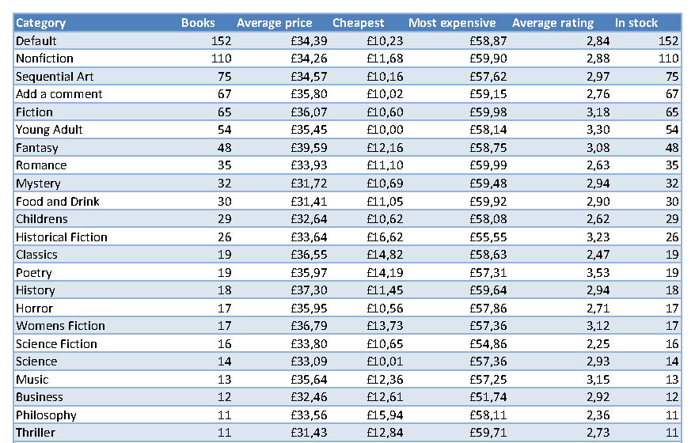
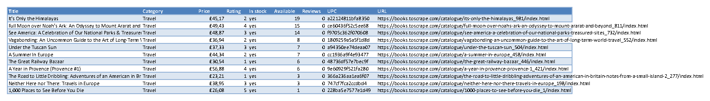

# Book price scraper

A polite, robust web scraper that collects every book from [books.toscrape.com](https://books.toscrape.com), a public sandbox built for scraping practice:
- title, category, price, rating and stock;
- with `--details`, also UPC, exact stock count and reviews.

Output: Excel with a per-category summary, CSV and JSON.

```text
python -m book_scraper -o all_books.xlsx --csv all_books.csv --json all_books.json

Travel
  page 1: 11 books (of 11)
Mystery
  page 1: 20 books (of 32)
  page 2: 12 books
…
1000 books, 82 requests, 41 s
Excel: all_books.xlsx
CSV:   all_books.csv
JSON:  all_books.json
```

All 1000 books, 82 requests, 41 seconds, at a deliberately gentle pace of one request every half second. The results of that run are in [`examples/`](examples).



With `--details` it also opens every book page:

```text
python -m book_scraper --category Travel --details -o travel.xlsx --csv travel.csv
```



## Built like a scraper for a real client

Scraping a site once is easy. These are the parts that make a scraper run unattended:

| | |
|---|---|
| **robots.txt** | Checked first for every site. A disallowed URL is never fetched |
| **Polite pace** | A fixed delay between requests to the same host (`--delay`, default 0.5 s). Time spent parsing counts towards it |
| **Retries** | Network errors, `429` and `5xx` responses are retried with exponential backoff (1 s, 2 s, 4 s). A `Retry-After` header is honoured |
| **Clear identity** | A descriptive User-Agent with a link to this repository |
| **Partial failures** | One broken book page does not stop the run. The book keeps its listing data, the failed URL is reported, and the exit code is `2` |
| **Cache** | `--cache .cache` keeps every downloaded page on disk, so re-runs while developing do not hit the site again |
| **Encoding** | Pages are decoded from their own charset declaration, so `’`, `é` and `£` arrive intact (the server's header says Latin-1, the page is UTF-8) |
| **Money** | Prices are `Decimal`, so averages and totals are exact |

## Quick start

Requires Python 3.10+.

```bash
python -m venv .venv
.venv\Scripts\activate          # Windows  (macOS/Linux: source .venv/bin/activate)
pip install -r requirements.txt

python -m book_scraper --category Poetry --details -o output/poetry.xlsx --csv output/poetry.csv
```

| Option | Meaning |
|---|---|
| `--category` | only one category (case-insensitive). An unknown name lists the valid ones |
| `--pages` | at most this many listing pages per category |
| `--details` | also open each book page: UPC, number available, reviews, full-size image |
| `-o, --output` | Excel file (default `output/books.xlsx`) |
| `--csv`, `--json` | also write CSV (UTF-8 with BOM, so Excel opens it correctly) and JSON |
| `--delay` | seconds between requests (default 0.5) |
| `--cache` | folder for a disk cache of downloaded pages |

## How it is built

```text
book_scraper/
  fetch.py    polite HTTP client: robots.txt, delay, retries/backoff, Retry-After, cache
  parse.py    HTML → data (BeautifulSoup); the only file that knows the page structure
  crawl.py    categories → listing pages (following "next") → optional book pages
  export.py   Excel (tables, £ format, hyperlinks, per-category summary), CSV, JSON
  cli.py      command line
```

Because all selectors live in `parse.py`, pointing the scraper at another shop, or fixing it after a site redesign, is a change in one file. Fetching, retrying, crawling and exporting stay the same.

## Tests

```bash
pip install pytest
pytest
```

The tests run against a small **fictional shop with the same markup**, served from memory, with no network and a fake clock:
- parsing of listing and detail pages;
- pagination, the category filter and the page limit;
- a failing book page;
- a robots.txt that forbids the catalogue;
- backoff timings, including `Retry-After`;
- the delay between requests;
- the cache;
- all three export formats and the command line.

## Responsible use

This project scrapes a site that exists to be scraped. For any other site:
- check its terms and its robots.txt;
- collect only public data, and never personal data;
- keep the pace gentle;
- prefer an official API or data export when there is one.

---

Prices and ratings on books.toscrape.com are random demo values set by the site. Built with AI assistance (Claude); reviewed and tested before publishing. MIT License.
